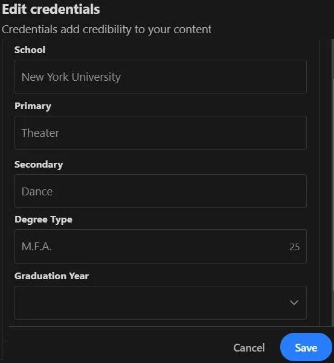

# Quora User Profile Creation

- [Quora User Profile Creation](#quora-user-profile-creation)
  - [Introduction](#introduction)
  - [Creating User Profile](#creating-user-profile)
  - [Registering on the Portal](#registering-on-the-portal)
    - [To sign up on the portal:](#to-sign-up-on-the-portal)
  - [Completing the Credentials and Highlights](#completing-the-credentials-and-highlights)
    - [To add the credential details:](#to-add-the-credential-details)
    - [To add the education details:](#to-add-the-education-details)
    - [To add the location details:](#to-add-the-location-details)

## Introduction
This user guide provides step-by-step instructions for creating a user profile on the Quora website. Quora is a digital platform that enables users to create, add, or post questions and answers.

## Creating User Profile
The following sections explain how to sign up and create a user profile on the Quora website.

## Registering on the Portal
> **Path**: *Quora Portal > Sign Up*

This section explains how users can sign up using their social accounts or email and secure their account with a password.

### To sign up on the portal:
1. Enter a name in the **Name** field on the Quora window.
2. Enter an email address in the **Email** field.
3. Enter a password in the **Password** field.
4. Check the **I'm not a robot** box and click **Sign Up**:

    > [!NOTE]
    >
    > The following information must be noted while creating an account:
    >
    > - Ensure the name and e-mail ID entered are accurate.
    > - Ensure the password entered contains at least one lower case, one upper case, and a numeric; if not, the following message displays:
    >
    >   *Please use a password with at least one lowercase letter, an uppercase letter, and a digit.*
5. Select the applicable topics or areas of interest that are displayed in the dialog box and click **Done** to complete the sign-up process.

## Completing the Credentials and Highlights
> **Path**: *Quora Portal > User Login > Credentials & Highlights*

This section describes how to add employment, education, and location details on the Quora main page window.

### To add the credential details:
1. From the **Credentials & Highlights** section, click **Add employment credential**.
2. Add the following information in the **Edit credentials** window:

   | Field                 | Description                                    |
   | --------------------- | ---------------------------------------------- |
   | Position              | Enter the name of the designation.             |
   | Company/Organization  | Enter the name of the company or organization. |
   | Start Year            | Select the start year from the drop-down list. |
   | End Year              | Select the end year from the drop-down list.   |
   | I currently work here | Check this box if currently employed.          |

   

3. Click **Save** to save the employment details.

### To add the education details:
1. From the **Credentials & Highlights** section, click **Add education credential**.
2. Add the following information in the **Edit credentials** window:

   | Field           | Description                                                                 |
   | --------------- | --------------------------------------------------------------------------- |
   | School          | Enter the name of the school or college.                                    |
   | Primary         | Enter primary education.                                                    |
   | Secondary       | Enter secondary education.                                                  |
   | Degree Type     | Enter the degree type, such as full-time, part-time, or distance education. |
   | Graduation Year | Select the graduation year from the drop-down list.                         |

   

3. Click **Save** to save the education details.

### To add the location details:
1. From the **Credentials & Highlights** section, click **Add location credential**.
2. Add the following information in the **Edit credentials** window:

   | Field                 | Description                                                  |
   | --------------------- | ------------------------------------------------------------ |
   | Location (required)   | Enter the appropriate location.                              |
   | Start Year            | Select the start year from the drop-down list.               |
   | End Year              | Select the end year from the drop-down list.                 |
   | I currently live here | Check this box if currently living in the selected location. |

   > [!NOTE]
   > The Start Year and the End Year indicate the tenure of residence in a particular location.

   

3. Click **Save** to save the location details.

   Once these details are added, the following cover page displays:

   
