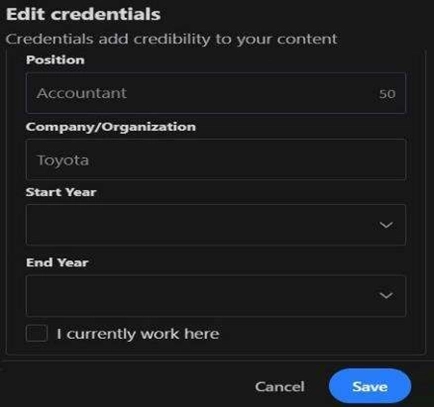
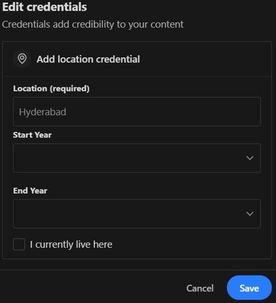

# Quora User Profile Creation

- [Quora User Profile Creation](#quora-user-profile-creation)
  - [Introduction](#introduction)
  - [Creating a User Profile](#creating-a-user-profile)
  - [Registering on the Portal](#registering-on-the-portal)
    - [To sign up on the portal](#to-sign-up-on-the-portal)
  - [Completing Credentials and Highlights](#completing-credentials-and-highlights)
    - [To add credential details](#to-add-credential-details)
    - [To add education details](#to-add-education-details)
    - [To add location details](#to-add-location-details)

## Introduction

This user guide provides step-by-step instructions for creating a user profile on the Quora website. Quora is a digital platform that enables users to create, add, or post questions and answers.

## Creating a User Profile

The following sections explain how to sign up and create a user profile on the Quora website.

## Registering on the Portal

> **Path:** *Quora Portal > Sign Up*

This section explains how users can sign up using their social accounts or email and secure their accounts with a password.

### To sign up on the portal

1. Enter a name in the **Name** field on the Quora window.
2. Enter an email address in the **Email** field.
3. Enter a password in the **Password** field.
4. Select the **I'm not a robot** check box and select **Sign Up**.

   **Note:** Keep the following information in mind when creating an account:

   - Ensure that the name and email address are accurate.
   - Ensure that the password contains at least one lowercase letter, one uppercase letter, and one digit. If it does not, the following message appears: *Please use a password with at least one lowercase letter, an uppercase letter, and a digit.*

5. Select the applicable topics or areas of interest displayed in the dialog box, and select **Done** to complete the sign-up process.

## Completing Credentials and Highlights

> **Path:** *Quora Portal > User Login > Credentials & Highlights*

This section describes how to add employment, education, and location details on the Quora home page.

### To add credential details

1. In the **Credentials & Highlights** section, select **Add employment credential**.
2. Add the following information in the **Edit credentials** window:

   | Field                 | Description                                          |
   | --------------------- | ---------------------------------------------------- |
   | Position              | Enter the name of the designation.                   |
   | Company/Organization  | Enter the name of the company or organization.       |
   | Start Year            | Select the start year from the drop-down list.       |
   | End Year              | Select the end year from the drop-down list.         |
   | I currently work here | Select this check box if you are currently employed. |

   

3. Select **Save** to save the employment details.

### To add education details

1. In the **Credentials & Highlights** section, select **Add education credential**.
2. Add the following information in the **Edit credentials** window:

   | Field           | Description                                                                 |
   | --------------- | --------------------------------------------------------------------------- |
   | School          | Enter the name of the school or college.                                    |
   | Primary         | Enter primary education.                                                    |
   | Secondary       | Enter secondary education.                                                  |
   | Degree Type     | Enter the degree type, such as full-time, part-time, or distance education. |
   | Graduation Year | Select the graduation year from the drop-down list.                         |

   

3. Select **Save** to save the education details.

### To add location details

1. In the **Credentials & Highlights** section, select **Add location credential**.
2. Add the following information in the **Edit credentials** window:

   | Field                 | Description                                                           |
   | --------------------- | --------------------------------------------------------------------- |
   | Location (required)   | Enter the appropriate location.                                       |
   | Start Year            | Select the start year from the drop-down list.                        |
   | End Year              | Select the end year from the drop-down list.                          |
   | I currently live here | Select this check box if you currently live in the selected location. |

   > [!NOTE]
   > The Start Year and End Year indicate the period of residence in a particular location.

   

3. Select **Save** to save the location details.

   Once these details are added, the following cover page displays:

   
